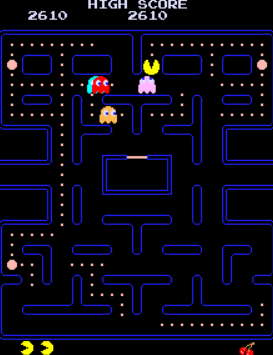

# Pac-Man
> Pac-Man és un vídeo joc d'acció ambientat en un laberint; el jugador controla el personatge homònim a través d'un laberint tancat. L'objectiu del joc és menjar tots els punts situats al laberint, evitant alhora quatre fantasmes de colors —Blinky (vermell), Pinky (rosa), Inky (cian) i Clyde (taronja)— que persegueixen Pac-Man.

**Autor:** [Alex Cano](https://github.com/alcaco-web/pacman-git)

---

[Jugar a Pac-Man online](https://pacmangratis.net/)

---

## Els Fantasmes de Pac-Man

- [Información sobre Blinky](blinky.md)
